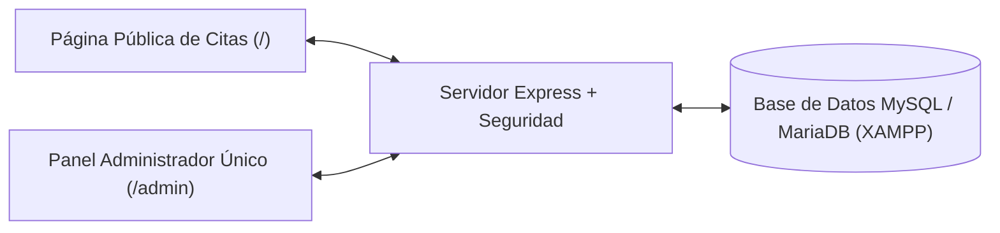

# Sistema de Citas y Panel de Administrador Único
**Hospital de Pequeñas Especies · UNAM FES Cuautitlán (Campo 4)**

Aplicación web modular compuesta por **dos páginas interconectadas** que comparten un mismo servidor y base de datos **MySQL / MariaDB en XAMPP** (con respaldo automático compatible con SQLite para pruebas rápidas):

1. **Página Pública de Citas (`/`):** Diseñada con **Bootstrap 5** priorizando la claridad, lectura cómoda y facilidad de uso para **personas mayores** (asistente paso a paso, botones grandes, alto contraste, ajuste de tamaño de letra `A- / A+ / A++` y comprobante imprimible).
2. **Panel de Administrador Único (`/admin`):** Diseñado priorizando la **seguridad**, controlado estrictamente por **una sola persona** (sin registro público, sesión única exclusiva, cierre por inactividad, cifrado `bcrypt`, protección CSRF, bloqueo contra fuerza bruta y bitácora de auditoría).

---

## ¿Cómo se interconectan las dos páginas?



- Cuando un dueño/tutor **agenda o cancela una cita** en `/`, el cambio aparece de inmediato en `/admin` y el cupo horario se actualiza automáticamente.
- Cuando el **administrador** confirma, reagenda, cancela citas, modifica el horario semanal, bloquea un día/horario o desactiva un servicio en `/admin`, la página pública `/` refleja el cambio al instante.

---

## Requisitos previos

- **Node.js v22.0 o superior**.
- **XAMPP (Apache + MariaDB/MySQL)** instalado en `C:\xampp` (para base de datos MySQL y visualización en `http://localhost/phpmyadmin`).
- **Git** (para control de versiones).

> Si alguna vez necesitas ejecutar el sistema sin XAMPP, basta con definir `DB_CLIENT=sqlite` en `.env` para usar SQLite integrado en Node.js.

---

## Instalación y puesta en marcha (paso a paso)

> **Nota para Windows PowerShell:** Si PowerShell bloquea `npm` por política de scripts, usa `npm.cmd` en lugar de `npm` (por ejemplo `npm.cmd install`), o ejecuta una sola vez `Set-ExecutionPolicy -Scope CurrentUser RemoteSigned`.

### 1. Instalar las dependencias del proyecto
Abre una terminal en la carpeta del proyecto y ejecuta:

```bash
npm install
```
*(En Windows PowerShell sin ExecutionPolicy habilitada: `npm.cmd install`)*.

### 2. (Opcional) Configurar variables de entorno
Copia el archivo de ejemplo `.env.example` como `.env` si deseas personalizar el puerto, la ruta de la base de datos o el tiempo de inactividad:

```bash
cp .env.example .env
```

> **Importante para producción:** Define un `SESSION_SECRET` largo y aleatorio (mínimo 32 caracteres) y usa `NODE_ENV=production` detrás de HTTPS. Nunca subas `.env` a Git.

### 3. Crear la cuenta del Administrador Único
El panel de administrador **no tiene registro web** por seguridad. Para crear (o restablecer) al único administrador autorizado ejecuta:

```bash
npm run setup-admin
```
*(En PowerShell: `npm.cmd run setup-admin`)*.

El asistente en consola te pedirá:
- Un nombre de usuario (ej. `admin_fesc`).
- Una contraseña segura (mínimo 10 caracteres, con mayúscula, minúscula, número y símbolo).

> Si algún día olvidas la contraseña del administrador, simplemente vuelve a ejecutar `npm run setup-admin` desde el servidor para reemplazarla de forma segura (esto también cierra cualquier sesión abierta).

### 4. Iniciar el servidor

```bash
npm start
```
*(Para desarrollo con reinicio automático al editar código: `npm run dev`)*.

Una vez encendido, abre en tu navegador:
- **Página Pública de Citas:** `http://localhost:3000/`
- **Panel de Administrador:** `http://localhost:3000/admin`

---

## Guía rápida de uso

### Para tutores / personas mayores (`/`)
1. **Accesibilidad en la barra superior:** Permite cambiar el tamaño de letra (**Normal**, **Grande**, **Muy grande**) y activar el modo **Alto contraste**. La preferencia queda guardada automáticamente en el navegador.
2. **Agendar una cita nueva (4 pasos claros):**
   - **Paso 1:** Elegir qué necesita la mascota (Consulta general, Vacunación, Desparasitación, Revisión o Especialidad).
   - **Paso 2:** Elegir el día (con botones rápidos como *Hoy*, *Mañana* o el calendario) y un horario disponible en formato de 12 horas (`9:00 a. m.`).
   - **Paso 3:** Llenar los datos del dueño/tutor y de la mascota con ejemplos visibles en cada campo.
   - **Paso 4:** Revisar el resumen y confirmar. Se genera un **folio fácil de leer** (sin caracteres confusos como `0/O` o `1/I/L`) y un botón grande para **Imprimir comprobante**.
3. **Consultar o cancelar mi cita:** Ingresando el **folio** y el **teléfono de 10 dígitos** registrados, el tutor puede ver el estado actual de su cita o cancelarla liberando ese lugar para otro paciente.

### Para el Administrador Único (`/admin`)
- **Pestaña 1 — Agenda y Citas:** Indicadores del día (Total, Pendientes, Confirmadas, Atendidas, Canceladas), filtros por fecha/estado/búsqueda, acciones rápidas (*Confirmar*, *Atendida*, *Cancelar*), modal de **Ver / Reagendar** con notas internas privadas y botón para **Imprimir agenda del día**.
- **Pestaña 2 — Horarios, Bloqueos y Servicios:** Permite abrir/cerrar días de la semana, cambiar hora de inicio/cierre, duración de cita y cupos por bloque; bloquear días festivos o franjas horarias específicas; y activar o pausar servicios veterinarios.
- **Pestaña 3 — Seguridad y Bitácora:** Cambio seguro de contraseña con lista visual de requisitos y consulta de los últimos 50 eventos de seguridad y operación (accesos, intentos fallidos, bloqueos, cambios en citas y horarios).

---

## Medidas de seguridad implementadas

| Protección | Cómo funciona |
| :--- | :--- |
| **Administrador único (Single-Admin)** | La tabla `admin_account` tiene restricción SQL `CHECK (id = 1)`. No existe registro público ni múltiples administradores. |
| **Sesión única exclusiva** | Solo puede haber **una sesión activa a la vez** (`active_session_id`). Si se inicia sesión en otro navegador, la sesión anterior se invalida de inmediato. |
| **Cierre automático por inactividad** | Expira la sesión en servidor y cliente tras 15 minutos sin actividad (configurable en `.env`), avisando 2 minutos antes. |
| **Contraseñas cifradas (`bcryptjs`)** | Las contraseñas nunca se guardan en texto plano; se almacenan con hash `bcrypt` de 12 rondas y comparación en tiempo constante. |
| **Anti-fuerza bruta + bloqueo temporal** | Límite de peticiones por IP (`express-rate-limit`) + bloqueo temporal de 15 minutos tras 5 intentos fallidos consecutivos. |
| **Protección CSRF + Cookies seguras** | Cookies `HttpOnly` y `SameSite=Strict`, regeneración de sesión al hacer login (anti Session Fixation) y validación de token `X-CSRF-Token` en tiempo constante + verificación de `Origin`. |
| **Cabeceras HTTP seguras (`Helmet` + aislamiento)** | Política CSP estricta (`'self'`), `Referrer-Policy: no-referrer`, `Permissions-Policy` restrictiva, `X-Frame-Options: DENY`, `CORP/COOP: same-origin` y `HSTS` en producción. |
| **Anti-caché y anti-indexación (`no-store`)** | Las rutas `/api/*` y `/admin` envían `Cache-Control: no-store` y `X-Robots-Tag: noindex, noarchive` para que equipos compartidos no almacenen datos personales ni vistas administrativas. |
| **Anti-secuestro de sesión y purga DOM** | La sesión del administrador se vincula a la huella del navegador (`User-Agent` hash SHA-256); si una cookie se reutiliza desde otro cliente, se revoca automáticamente y se audita. Al cerrar sesión, el panel purga datos de pacientes del DOM. |
| **Minimización de datos personales (PII)** | En consultas públicas (`/api/public/appointments/lookup`) se ocultan IDs internos y notas privadas, y se enmascaran teléfono (`******5678`) y correo (`ma***@dominio.com`). |
| **Fetch Metadata, HPP y Prototype Pollution** | Bloquea peticiones `Sec-Fetch-Site: cross-site` (`403`), rechaza cuerpos que no sean JSON (`415`), parámetros repetidos y claves peligrosas (`__proto__`, `constructor`, `prototype`). |
| **Prevención de SQL Injection y XSS** | Todas las consultas SQL son parametrizadas, todas las entradas se validan con `Zod` y el frontend construye el DOM con `textContent` / `createEl` sin `innerHTML`. |
| **Sin enlace público al administrador** | La página de citas (`/`) no muestra ningún botón ni enlace hacia `/admin`; solo la persona autorizada accede escribiendo la ruta administrativa. |
| **Bitácora de auditoría** | Registra en `audit_logs` inicios de sesión, intentos fallidos, bloqueos, alertas de sesión, cambios de contraseña y modificaciones en citas o agenda. |

---

## Estructura modular del proyecto

Todo el código está dividido por responsabilidades y comentado internamente en español para que cualquier persona ajena al desarrollo original pueda entenderlo y mantenerlo fácilmente:

```text
.
├── README.md                        # Esta guía de instalación, uso y arquitectura
├── package.json                     # Dependencias y scripts (start, dev, setup-admin, test)
├── .env.example                     # Plantilla de configuración (variables de entorno)
├── .gitignore                       # Archivos excluidos de Git (.env, BD local, node_modules)
├── scripts/
│   └── setup-admin.js               # Asistente de consola para crear/restablecer al único admin
├── src/
│   ├── server.js                    # Punto de entrada del servidor HTTP
│   ├── app.js                       # Configuración de Express, Helmet, sesiones y rutas
│   ├── config/
│   │   └── constants.js             # Datos institucionales UNAM FESC y parámetros base
│   ├── db/
│   │   ├── database.js              # Adaptador unificado MySQL/XAMPP (mysql2) y SQLite
│   │   ├── schema.mysql.sql         # Esquema MySQL/MariaDB (InnoDB, utf8mb4, CHECK id = 1)
│   │   └── schema.sql               # Esquema SQLite equivalente (para pruebas/respaldo)
│   ├── middleware/
│   │   ├── auth.middleware.js       # Verifica sesión activa exclusiva y timeout
│   │   ├── csrf.middleware.js       # Generación y verificación de token X-CSRF-Token
│   │   ├── rateLimit.middleware.js  # Límites anti-fuerza bruta y abuso de endpoints
│   │   └── error.middleware.js      # Manejo centralizado de errores sin filtrar detalles internos
│   ├── validators/
│   │   ├── appointment.validator.js # Reglas Zod para citas públicas y edición admin
│   │   └── admin.validator.js       # Reglas Zod para login, contraseña fuerte, horarios y bloqueos
│   ├── services/
│   │   ├── appointment.service.js   # Creación atómica de citas, folios, búsqueda y agenda
│   │   ├── schedule.service.js      # Cálculo de disponibilidad, horarios semanales y bloqueos
│   │   ├── auth.service.js          # Hash bcrypt, sesión única y bloqueo tras intentos fallidos
│   │   └── audit.service.js         # Registro y consulta de la bitácora de auditoría
│   └── routes/
│       ├── public.routes.js         # API pública (/api/public/*)
│       └── admin.routes.js          # API protegida del administrador (/api/admin/*)
├── public/
│   ├── index.html                   # Página pública de citas (Bootstrap 5 + accesibilidad)
│   ├── admin.html                   # Panel de administrador único (Bootstrap 5)
│   ├── css/
│   │   ├── theme.css                # Tema UNAM + modos de letra grande, alto contraste e impresión
│   │   └── admin.css                # Estilos operativos del panel de administrador
│   └── js/
│       ├── shared/api.js            # Cliente HTTP compartido, soporte CSRF y helpers DOM seguros
│       ├── citas/                   # Módulos del portal público (app.js, wizard.js, lookup.js)
│       └── admin/                   # Módulos del panel admin (app.js, auth.js, appointments.js, schedule.js)
├── tests/
│   └── api.test.js                  # Pruebas automatizadas de integración y seguridad
└── .agent/skills/hospital-citas-fesc/
    └── SKILL.md                     # Skill local del proyecto (contrato de API y convenciones)
```

---

## Pruebas automatizadas

El proyecto incluye una suite de pruebas de integración y seguridad que usa el corredor nativo `node:test` (sin dependencias extra):

```bash
npm test
```
*(En PowerShell: `npm.cmd test`)*.

Verifica automáticamente:
1. Entrega de páginas HTML, Bootstrap local y cabeceras Helmet CSP.
2. Flujo público completo (disponibilidad, reserva atómica, reducción de cupo y privacidad en consulta).
3. Seguridad del administrador (`401` sin sesión, `403` sin CSRF, invalidación de sesión previa al iniciar sesión en otro navegador).
4. Sincronización bidireccional (confirmación de cita, bloqueo y desbloqueo de horarios reflejados al instante en la página pública, y cancelación).
5. Bloqueo temporal de la cuenta tras 5 intentos fallidos de inicio de sesión.

---

## Despliegue a Internet (Producción)

El proyecto está preparado para subir directamente desde GitHub a plataformas en la nube (**Railway**, **Render**, **Fly.io**, **Docker** o **VPS**):

- **Archivos incluidos:** `Dockerfile` (usuario no-root `node:22-alpine` + `HEALTHCHECK`), `.dockerignore`, `render.yaml` y `public/robots.txt`.
- **Soporte de MySQL en la nube:** acepta `MYSQL_URL` / `DATABASE_URL`, variables `MYSQL*` de Railway o `DB_*` separadas, además de cifrado `DB_SSL=true`.
- **Zona horaria fija de México:** usa `HOSPITAL_TIMEZONE=America/Mexico_City` para que los horarios nunca se desfasen en servidores UTC.
- **Monitoreo de salud:** endpoint `GET /health` que valida conectividad real con la base de datos.
- **Privacidad del administrador en internet:**
  - Define **`ADMIN_PATH=/tu-ruta-secreta`** (por ejemplo `/control-fesc-9x7k`): las rutas `/admin` y `/admin.html` devolverán `404` para cualquier persona o escáner.
  - Opcionalmente define **`ADMIN_ALLOWED_IPS`** si quieres restringir el panel a ciertas IPs (déjalo vacío para poder acceder desde tu celular).
  - También soporta **`APP_MODE=public`** si alguna vez prefieres desplegar solo el portal público en la nube y abrir el panel solo desde tu equipo conectado a la misma BD.
- **Variables obligatorias en producción:**
  - `NODE_ENV=production`
  - `TRUST_PROXY=true`
  - `SESSION_SECRET` (mínimo 32 caracteres aleatorios)
  - `DB_CLIENT=mysql` + `MYSQL_URL` (o `DB_HOST`/`DB_PORT`/`DB_USER`/`DB_PASSWORD`/`DB_NAME`) y `DB_SSL=true` si el proveedor lo solicita.
  - En el primer arranque sin consola interactiva puedes definir temporalmente `ADMIN_USERNAME` y `ADMIN_PASSWORD` para crear la cuenta única y luego borrarlos del panel.

---

## Solución rápida de problemas

- **Error `npm.ps1 no se puede cargar porque la ejecución de scripts está deshabilitada`:** Usa `npm.cmd` en lugar de `npm` (ej. `npm.cmd start`).
- **El panel `/admin` dice que falta configurar al administrador:** Ejecuta `npm run setup-admin` (o `npm.cmd run setup-admin`) en la terminal y recarga la página.
- **Puerto `3000` ocupado:** Crea un archivo `.env` con `PORT=3001` y vuelve a ejecutar `npm start`.
- **Olvidé la contraseña del administrador:** Ejecuta `npm run setup-admin` en el equipo servidor para definir una nueva contraseña segura.
